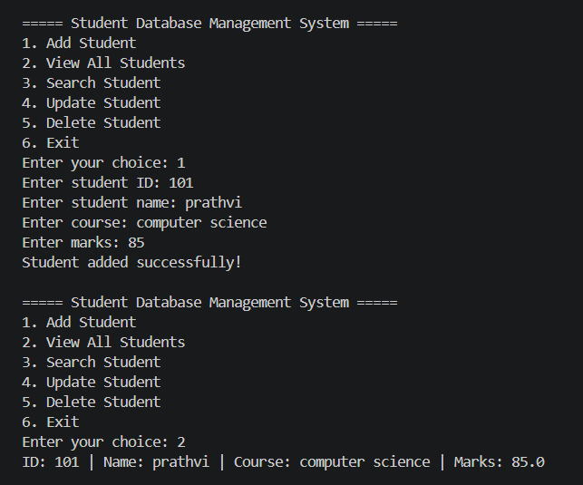

# Student Database Management System

A simple console-based application developed using Java.

## Features
- Add student records
- View all students
- Search students by ID
- Update student details
- Delete student records
- Prevent duplicate student IDs

## Technologies Used
- Java
- Object-Oriented Programming (OOP)
- ArrayList
- Scanner

## How to Run

Compile the program:

    javac StudentDatabaseManagementSystem.java

Run the program:

    java StudentDatabaseManagementSystem

## Output

## Note
Student records are stored temporarily in memory.
They are not saved after the program exits.

